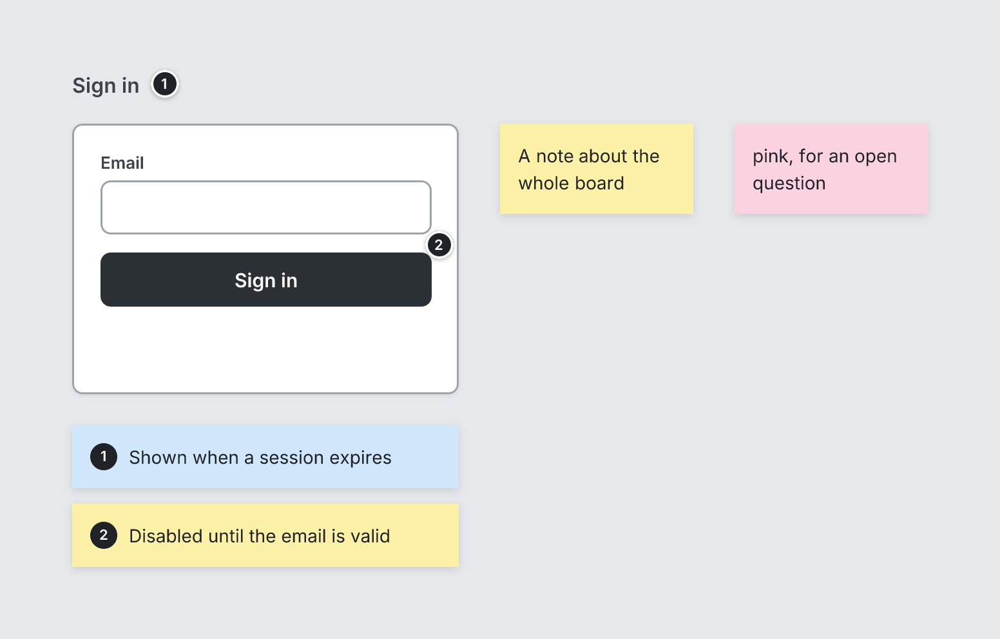

# Note

`note` · Canvas · [All components](README.md)

A note for the reader about what it's indented under: the board, a screen, or any element (rule 12). Drawn outside the screen, never in the layout.



```tsquare
board gap=32
  screen custom "Sign in" width=300 height=210
    note "Shown when a session expires" color=blue
    input email "Email"
    button primary "Sign in" fullWidth
      note "Disabled until the email is valid"
  note "A note about the whole board" width=150
  note "pink, for an open question" color=pink width=150
```

## Writing it

- A quoted string sets **text**: `note "…"`.
- Bare words set **color**: `yellow`, `blue`, `pink`, `green`.
- Anything else is written `key=value`.
- Has no children.

## Props

| Prop | Values | Notes |
|---|---|---|
| `text` *(main text, required)* | string |  |
| `color` | yellow, blue, pink, green |  |
| `width` | number |  |
